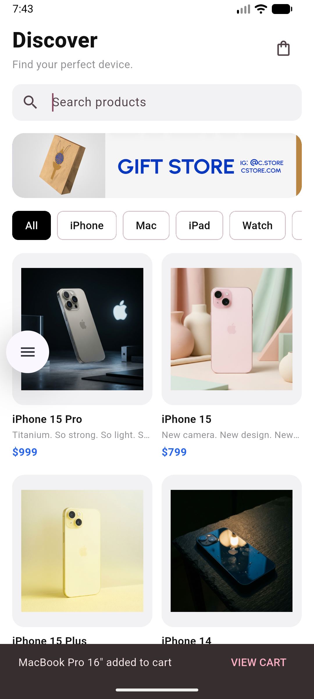
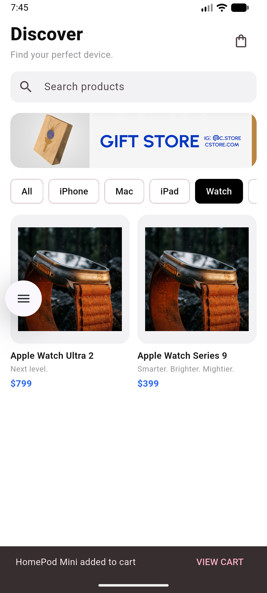
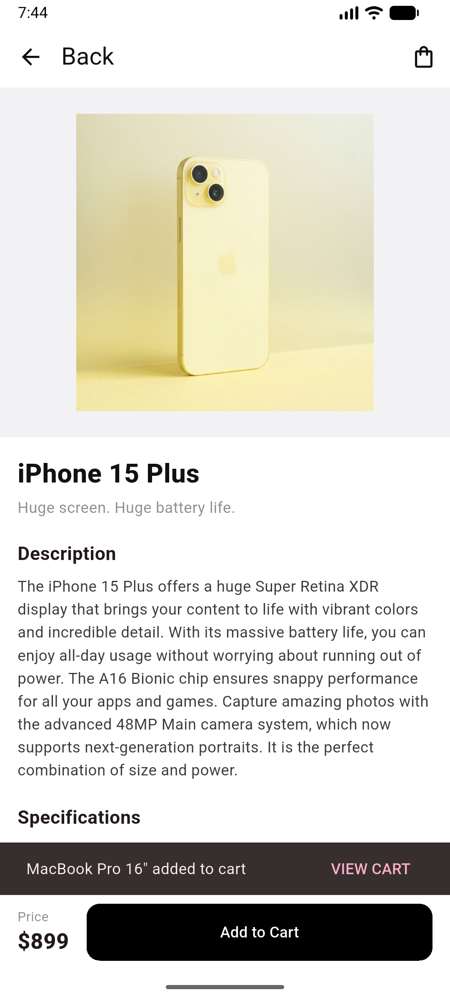
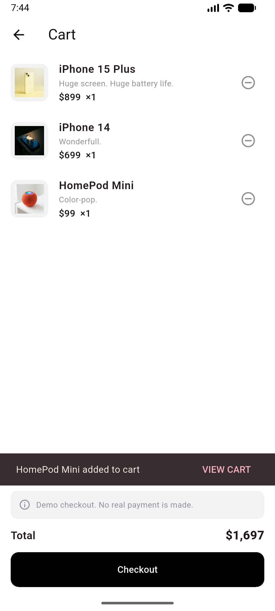
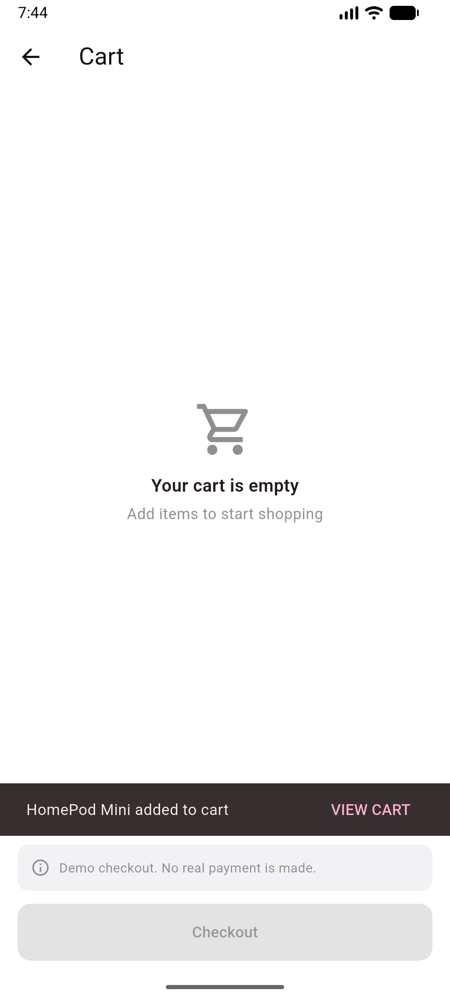

# Mini Katalog Uygulaması

Flutter ile geliştirilmiş, basit fakat profesyonel görünümlü bir ürün katalog uygulaması. Kullanıcı ürünleri listeleyebilir, arayıp kategoriye göre filtreleyebilir, ürün detaylarını inceleyebilir ve ürünleri sepete ekleyip çıkarabilir (sepet ve ödeme simülasyondur).

Bu proje, Flutter haftalık eğitimi kapsamında hazırlanmıştır.

## Kullanılan Teknolojiler

- **Flutter:** 3.47.8 (stable)
- **Dil:** Dart
- **Paketler:** Yalnızca `material.dart` (ekstra paket kullanılmamıştır)
- **Geliştirme ortamı:** Visual Studio Code, Android Studio (Emulator)

## Özellikler

- Ana sayfa: başlık, arama kutusu, banner ve `GridView` ile 2 sütunlu ürün kartları
- Arama ve kategori filtreleme (All, iPhone, Mac, iPad, Watch, Audio, Other)
- Ürün detay sayfası: görsel, açıklama ve teknik özellikler
- Sepete ekleme / çıkarma, toplam tutar ve checkout simülasyonu
- Boş sepet ekranı
- Named Routes ve Route Arguments ile sayfalar arası geçiş
- JSON verisinden model sınıfına dönüşüm (`fromJson` / `toJson`)
- `Image.asset` ile yerel görsel kullanımı

## Proje Klasör Yapısı

```
lib/
├── main.dart                 # Uygulama başlangıcı ve route tanımları
├── models/                   # Product ve CartItem model sınıfları
├── services/                 # JSON okuma ve sepet yönetimi
├── screens/                  # Ana sayfa, ürün detay ve sepet ekranları
├── widgets/                  # Tekrar kullanılan arayüz parçaları
├── routes/                   # Sayfa adları (named routes)
├── theme/                    # Renkler ve tema
└── utils/                    # Yardımcı fonksiyonlar
assets/
├── data/products.json        # Ürün verisi
└── images/                   # Banner ve ürün görselleri
```

## Çalıştırma Adımları

1. Flutter SDK'nın kurulu olduğundan emin olun:
   ```bash
   flutter doctor
   ```
2. Projeyi klonlayın:
   ```bash
   git clone https://github.com/nisademir1/mini_katalog.git
   cd mini_katalog
   ```
3. Bağımlılıkları yükleyin:
   ```bash
   flutter pub get
   ```
4. Bir Android emülatörü başlatın veya fiziksel cihaz bağlayın, ardından uygulamayı çalıştırın:
   ```bash
   flutter run
   ```

## Ekran Görüntüleri

| Ana Sayfa | Arama / Filtre | Ürün Detayı |
|---|---|---|
|  |  |  |

| Sepet | Boş Sepet |
|---|---|
|  |  |

## Veri Kaynağı

Ürün verileri ve görseller eğitim amacıyla [wantapi.com](https://wantapi.com/products.php) adresinden alınmış ve uygulama içinde `assets` klasöründe JSON simülasyonu olarak kullanılmıştır. Bu veriler gerçek bir e-ticaret altyapısını temsil etmez. Ürün adları ve markalar sahiplerine aittir.

## Geliştirici

Meryem Nisa Demir — [@nisademir1](https://github.com/nisademir1)